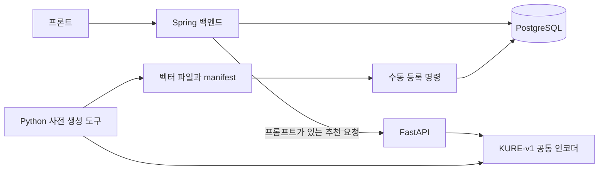

# ShortsB Backend

원하는 쪽수와 이야기 성향을 선택해 작품의 발췌를 읽고, 대비되는 다른 작품을 살펴본 뒤 전체 독서로 이어지는 서비스의 Spring 백엔드입니다.

이 저장소는 Google 로그인, 도서·페이지 조회, 추천 계산, 대비 근거 검증, 전체 독서 기록과 PostgreSQL 데이터 등록을 담당합니다. 임베딩 모델 실행과 사전 벡터 생성은 별도 `ShortsB-AI` 프로젝트가 담당합니다.

> 현재 확인한 실행 구성은 로컬 프론트·Spring·PostgreSQL과 제공 GPU 서버의 FastAPI입니다. VPN·PuTTY SSH 터널로 노트북의 `127.0.0.1:18001`을 GPU 서버의 `127.0.0.1:8001`에 연결합니다. 인증정보는 실행 환경에 주입하며 `.env.example`에는 실제 값을 넣지 않습니다.

## 주요 기능

| 기능 | 설명 |
| --- | --- |
| Google 로그인 | OIDC 로그인, 최초 회원 생성, 서버 세션과 쿠키 기반 인증 |
| 첫 발췌 추천 | 요청 쪽수·필수 이야기 카드·선택 프롬프트를 반영한 작품 및 대목 선택 |
| 발췌 재조회 | 현재 로그인 세션에 보관한 참조로 동일한 원본 페이지 조회 |
| 대비 발췌 | 사람이 승인한 양쪽 근거·공통 주제·대비 설명을 만족하는 다른 작품 제공 |
| 전체 독서 | 선택한 책의 첫 페이지부터 시작, 현재 위치 저장·이어 읽기·전체 책 완료 |
| 데이터 등록 | 도서·페이지·사전 벡터 및 대비 검수 자료의 명시적 검증·DB 반영 |

사용자 흐름은 다음과 같습니다.

```text
Google 로그인
  → 발췌 쪽수 1~10쪽 선택
  → 이야기 카드 선택 + 선택 자유 프롬프트
  → 첫 작품 발췌
  → 근거가 있는 경우 대비 작품 발췌
  → 읽을 작품 선택
  → 전체 독서 시작·저장·재개·완료
```

- 카드는 `WARM`·`HUMOR`·`THOUGHTFUL`·`ANY` 중 하나가 필수입니다.
- `ANY`는 ‘무엇이든 좋아요’라는 유효한 선택입니다.
- 서비스 페이지는 제공 자료의 `pages` 항목 하나를 기준으로 합니다. API 페이지 번호는 1부터 시작합니다.
- 실제 발췌 수는 `min(요청 쪽수, 작품 전체 쪽수)`입니다. 짧은 작품도 제공할 수 있습니다.
- 발췌량은 전체 독서 진행률에 합산하지 않습니다.
- 유효한 대비 근거가 없으면 대비를 생략하고 첫 작품의 전체 독서를 허용합니다.

## 기술 스택과 구성

| 영역 | 사용 기술 |
| --- | --- |
| 언어 | Java 21 |
| 애플리케이션 | Spring Boot 4.1.2, Spring MVC |
| 인증·보안 | Spring Security, OAuth2 Client, Google OIDC, CSRF, CORS |
| 데이터 접근 | Spring Data JPA, JdbcTemplate, PostgreSQL |
| 내부 HTTP 연결 | Spring RestClient |
| API 문서 | springdoc OpenAPI 3.2.0 |
| 빌드 | Gradle Wrapper |
| 별도 AI 프로젝트 | Python, FastAPI, PyTorch, Sentence Transformers, KURE-v1 |



- **Spring**: 인증·입력 검증·추천 점수·페이지 범위·대비 정책·독서 기록·DB 등록을 처리합니다.
- **FastAPI**: 시작 시 모델을 로딩하고 재사용하며 프롬프트의 임베딩 벡터와 모델 상태를 반환합니다. DB나 Google 세션에 직접 접근하지 않습니다.
- **사전 생성 도구**: 도서 본문과 카드 검색 문장을 임베딩하고 원본 ID·해시·모델 정보를 파일에 기록합니다.
- **프론트**: Spring의 API를 호출합니다. FastAPI를 직접 호출하지 않습니다.

벡터는 PostgreSQL의 `double precision[]`에 저장합니다. 현재 초기 자료 규모에서는 Spring이 코사인 유사도를 계산하며 별도 벡터 DB나 `pgvector`는 사용하지 않습니다.

## 추천 방식

| 이야기 카드 | 자유 프롬프트 | 처리 방식 | 온라인 FastAPI 호출 |
| --- | --- | --- | --- |
| WARM / HUMOR / THOUGHTFUL | 없음 | 해당 카드의 사전 벡터와 본문 벡터 비교 | 없음 |
| WARM / HUMOR / THOUGHTFUL | 있음 | 카드·프롬프트 각각의 본문 유사도 점수 조합 | 있음 |
| ANY | 있음 | 프롬프트와 본문 벡터 비교 | 있음 |
| ANY | 없음 | 승인된 작품 중 작품별 균등 무작위 선택, 첫 페이지부터 발췌 | 없음 |

카드와 프롬프트를 함께 입력한 경우 기본 점수는 다음과 같습니다.

```text
점수 = 0.4 × 코사인 유사도(카드, 본문)
     + 0.6 × 코사인 유사도(프롬프트, 본문)
```

`APP_RECOMMENDATION_PROMPT_WEIGHT`로 프롬프트 비중을 0~1 사이에서 조정할 수 있습니다. 카드 비중은 나머지입니다. 벡터 검색으로 고른 페이지를 포함하는 연속 발췌를 제공하며, 책 끝에서는 시작점을 조정합니다.

대비 추천은 `결·시선·어조·태도·결말·시대/배경`의 6개 축을 사용합니다. 사람이 승인한 관계 중 실제 양쪽 발췌에 근거가 포함되는 후보만 사용하고, 기존 본문 벡터로 후보 발췌를 비교합니다. 유사도가 낮다는 사실만으로 대비를 판정하거나 설명을 생성하지 않습니다.

## 저장소 구조

```text
src/main/java/com/shortsb/
├── auth/             # Google 인증·세션·CSRF·CORS
├── user/             # 회원 생성·조회
├── book/             # 도서·페이지 조회와 수동 데이터 등록
├── embedding/        # FastAPI 연결·모델 및 벡터 응답 검증
├── recommendation/   # 첫 발췌·대비 추천·검수 등록
├── reading/          # 전체 독서 시작·위치 저장·완료
└── common/           # 공통 오류·로컬 OpenAPI 설정
src/main/resources/   # 공통·local·prod 설정
src/test/             # 기존 테스트 코드
docs/                 # 제품·구조·API·DB·작업 문서
scripts/              # 대비 후보 검토 양식 생성 도구
```

도메인 내부는 역할에 따라 `controller`, `dto`, `repository`, `service`, `service/impl`, `config`, `command` 등으로 구성합니다.

## 로컬 실행

아래 절차는 새로운 실행 환경을 준비하는 방법입니다. 기존 시연 환경은 사용자가 직접 실행해 확인했습니다. README 수정 과정에서 Codex가 Spring 빌드·테스트·DB 적용·git을 실행한 것은 아닙니다.

### 1. 준비 사항

- JDK 21
- 실행 중인 PostgreSQL과 사용할 DB·접속 계정
- Google 웹 애플리케이션 OAuth 클라이언트 ID·비밀값
- 프론트의 실제 로컬 주소
- 프롬프트 추천을 확인할 경우 실행 중인 GPU 서버의 `ShortsB-AI`, VPN·SSH 터널 및 서버와 같은 설정으로 생성한 사전 벡터

예시 작업 폴더는 다음과 같습니다. 프론트 위치와 실행 포트는 해당 프로젝트 설정을 따릅니다.

```text
ShortsB/
├── ShortsB-BE/
└── ShortsB-AI/
```

### 2. DB 스키마 준비

Spring 설정은 `ddl-auto=validate`, `sql.init.mode=never`입니다. 앱 실행으로 테이블을 자동 생성하거나 갱신하지 않습니다.

| DB 상태 | 적용 방법 |
| --- | --- |
| 비어 있는 새 DB | `docs/database/schema.sql`을 한 번 적용 |
| 기존 R1 DB | 백업·적용 이력 확인 후 `001-content-embeddings.sql` → `002-whole-book-reading.sql` → `003-contrast-relations.sql` 순서로 미적용 변경만 반영 |
| 최신 초기 스키마가 적용된 DB | 같은 변경 SQL을 중복 적용하지 않음 |

예를 들어 DB와 계정 이름을 `shortsb`로 준비했다면, 빈 DB에 적용하는 명령은 다음과 같습니다. 계정·DB 이름은 실제 환경에 맞춥니다.

```bash
psql -h localhost -p 5432 -U shortsb -d shortsb -v ON_ERROR_STOP=1 -f docs/database/schema.sql
```

### 3. 환경변수 설정

`.env.example`은 변수 목록과 설명입니다. **Spring은 `.env` 파일을 자동으로 읽지 않습니다.** IntelliJ 실행 설정이나 실제 실행 셸의 환경변수로 주입해야 합니다.

다음 값은 프론트를 `http://localhost:5173`에서 실행한다고 가정한 예시입니다. 프론트 주소가 다르면 로그인 이동 주소와 허용 출처를 함께 바꿉니다.

```dotenv
SPRING_PROFILES_ACTIVE=local
SPRING_DATASOURCE_URL=jdbc:postgresql://localhost:5432/shortsb
SPRING_DATASOURCE_USERNAME=실제_DB_계정
SPRING_DATASOURCE_PASSWORD=실제_DB_비밀번호

GOOGLE_CLIENT_ID=발급받은_클라이언트_ID
GOOGLE_CLIENT_SECRET=발급받은_클라이언트_비밀값
GOOGLE_REDIRECT_URI=http://localhost:8080/login/oauth2/code/google

APP_LOGIN_SUCCESS_URL=http://localhost:5173/
APP_LOGIN_FAILURE_URL=http://localhost:5173/?login=failed
APP_CORS_ALLOWED_ORIGINS=http://localhost:5173

APP_EMBEDDING_BASE_URL=http://127.0.0.1:18001
```

이 블록은 그대로 자동 로딩되는 설정 파일이 아닙니다. 실제 값으로 바꿔 실행 환경에 등록하고, 비밀값은 공유 문서나 소스에 기록하지 않습니다. CORS 출처에는 경로나 마지막 `/`를 넣지 않습니다.

선택 설정은 다음과 같습니다. 기본값을 사용하려면 해당 변수를 생략할 수 있습니다.

| 환경변수 | 기본값·용도 |
| --- | --- |
| `SERVER_SERVLET_SESSION_TIMEOUT` | 비활성 세션 만료 시간, 기본 `30m` |
| `SERVER_SERVLET_SESSION_COOKIE_SECURE` | `local`은 기본 `false`, `prod`·프로필 미지정은 기본 `true` |
| `SERVER_SERVLET_SESSION_COOKIE_SAME_SITE` | 기본 `lax` |
| `APP_EMBEDDING_API_KEY` | FastAPI에 보낼 `X-API-Key`; FastAPI의 `EMBEDDING_API_KEY`와 일치해야 함 |
| `APP_EMBEDDING_CONNECT_TIMEOUT` | 기본 `2s` |
| `APP_EMBEDDING_READ_TIMEOUT` | 기본 `30s` |
| `APP_RECOMMENDATION_PROMPT_WEIGHT` | 기본 `0.6` |

`APP_EMBEDDING_BASE_URL`의 코드 기본값도 SSH 포워딩용 `http://127.0.0.1:18001`입니다. 별도로 FastAPI를 같은 PC의 `8001`에서 실행한다면 `http://127.0.0.1:8001`로 변경합니다. 실제 인증정보가 포함된 환경 파일은 커밋하지 않습니다.

### 4. Google 로그인 설정

Google 콘솔에서 해당 웹 애플리케이션의 승인된 리디렉션 URI에 아래 주소를 등록합니다.

```text
http://localhost:8080/login/oauth2/code/google
```

이 값은 `GOOGLE_REDIRECT_URI`와 정확히 같아야 합니다. 동의 화면 설정에 따라 로그인할 테스트 계정도 준비합니다.

- 로그인 시작은 `http://localhost:8080/oauth2/authorization/google`로 브라우저 페이지를 이동시켜 수행합니다.
- 브라우저에서 사용하는 로그인·콜백·API 주소는 `localhost`와 `127.0.0.1`을 혼용하지 않습니다.
- 프론트 API 요청은 `credentials: 'include'` 또는 동일한 쿠키 포함 옵션을 사용합니다.
- 로그인·로그아웃 후에는 `GET /api/csrf`에서 토큰을 다시 조회합니다.
- 상태 변경 요청에는 응답의 `headerName`에 맞춰 토큰을 전달합니다. 현재 헤더 이름은 `X-CSRF-TOKEN`입니다.

### 5. Spring 실행과 Swagger

환경변수를 등록한 뒤 저장소 루트에서 실행합니다.

```bash
./gradlew bootRun
```

Windows PowerShell에서는 다음 명령을 사용할 수 있습니다.

```powershell
.\gradlew.bat bootRun
```

IntelliJ에서는 `ShortsBBeApplication`을 실행할 수 있습니다. 기본 HTTP 포트는 `8080`입니다.

| 주소 | 용도 |
| --- | --- |
| `http://localhost:8080/swagger-ui/index.html` | 로컬 Swagger UI |
| `http://localhost:8080/v3/api-docs` | 로컬 OpenAPI 문서 |
| `http://localhost:8080/oauth2/authorization/google` | Google 로그인 시작 |

Swagger는 `local` 프로필에서만 공개합니다. `prod`·프로필 미지정 시 비활성화하며 `local`과 `prod`를 함께 지정해도 공개하지 않습니다.

## 도서·임베딩 데이터 준비

사용자가 15개 작품·864페이지, GPU 생성 본문 벡터 864개·카드 벡터 3개 및 활성 추천 설정 1건의 로컬 DB 등록을 확인했습니다. 새로운 DB에는 아래 절차로 데이터를 준비해야 합니다. 구절/해시 검증과 작품의 공개 이용 조건 검토는 별개입니다.

### 입력 자료 확보

원본 자료·카탈로그·벡터는 일부 `.gitignore` 제외 대상입니다. GitHub 소스만 내려받았다고 데이터가 함께 준비되는 것은 아닙니다. 임베딩 산출물은 아래 링크에서 내려받고 제공된 파일을 다음 위치에 배치합니다. 묶음에 없는 원본·카탈로그는 별도로 준비해야 합니다. 인증정보나 개인 DB 덤프를 자료 묶음에 포함하지 않습니다.

- [임베딩 산출물 다운로드 — Google Drive](https://drive.google.com/file/d/1CGvm3BOziZGNqz-rcfsDLtORNrPosMtI/view?usp=sharing)

| 자료 | 배치 위치 | 용도 |
| --- | --- | --- |
| 책 원본 `books.json` | `ShortsB-BE/docs/shortB-15books-texts/books.json` | 카탈로그를 처음부터 만드는 경우 |
| 카탈로그 3개 파일 | `ShortsB-AI/data/catalog-v1/` | `catalog-metadata.json`, `segments.jsonl`, `manifest.json` |
| 본문 벡터·manifest | `ShortsB-AI/outputs/documents-v1/` | GPU 사전 생성 결과 |
| 카드 벡터·manifest | `ShortsB-AI/outputs/cards-v1/` | GPU 사전 생성 결과 |

카탈로그 묶음을 받았다면 원본 변환을 다시 수행할 필요가 없습니다. 벡터 묶음을 받았다면 모델 설정을 확인하고 등록하며, 없으면 AI README의 고정 환경에서 사전 생성합니다. 경로는 위 형제 프로젝트 배치를 기준으로 합니다.

### 검증·등록

1. `ShortsB-AI`의 준비 도구로 도서 메타데이터·페이지 입력·manifest 묶음을 준비합니다.
2. 같은 AI 환경에서 본문 864개와 카드 3종의 벡터를 생성하고 산출물을 검증합니다.
3. `importCatalog`로 파일을 검증한 뒤 명시적으로 DB에 반영합니다.
4. 작품별 이용 근거를 검수하고 제공 승인 상태를 반영합니다.
5. 대비를 제공하려면 양쪽 근거·설명·검수자가 포함된 승인 자료도 등록합니다.

도서 입력만 검증하는 예시입니다. `--validate-only`에서는 DB에 반영하지 않습니다.

```bash
./gradlew importCatalog --args='--catalog-dir ../ShortsB-AI/data/catalog-v1 --validate-only'
```

파일 검증을 마친 도서 묶음을 DB에 등록하는 예시입니다. DB 환경변수와 스키마가 먼저 준비되어 있어야 합니다.

```bash
./gradlew importCatalog --args='--catalog-dir ../ShortsB-AI/data/catalog-v1 --apply'
```

이 명령은 도서만 등록합니다. 벡터와 활성 추천 설정까지 등록하려면 실제 생성한 본문·카드 산출물을 함께 지정합니다.

```bash
./gradlew importCatalog --args='--catalog-dir ../ShortsB-AI/data/catalog-v1 --documents-dir ../ShortsB-AI/outputs/documents-v1 --cards-input ../ShortsB-AI/config/cards-v1.jsonl --cards-dir ../ShortsB-AI/outputs/cards-v1 --validate-only'
./gradlew importCatalog --args='--catalog-dir ../ShortsB-AI/data/catalog-v1 --documents-dir ../ShortsB-AI/outputs/documents-v1 --cards-input ../ShortsB-AI/config/cards-v1.jsonl --cards-dir ../ShortsB-AI/outputs/cards-v1 --apply'
```

- 예시 경로는 실제 준비한 파일 위치에 맞춥니다. AI 프로젝트의 `data/`·`outputs/`는 버전 관리 제외 대상입니다.
- 등록 명령은 웹 서버·Google 로그인·FastAPI를 시작하지 않습니다. DB 반영에는 DB 환경변수 3개가 필요합니다.
- 신규 도서는 기본 `content_rights=unverified`입니다. 승인 전에는 추천·도서 조회 대상이 되지 않습니다.
- 본문 전체와 카드 3종을 검증·등록한 경우에만 활성 추천 모델 설정을 반영합니다.
- 동일 데이터는 재사용하고, 기존 값과 다른 데이터는 자동으로 덮어쓰지 않습니다.
- CSV 대비 후보는 검토 대기 자료입니다. 후보 등록만으로 대비가 제공되지 않습니다.

대비 시연용으로 `docs/database/contrast-seed.sql`에 45개 방향성 관계의 구절·설명이 준비되어 있습니다. 도서의 승인 상태를 먼저 준비한 뒤 내용을 확인하고 pgAdmin에서 전체 실행합니다. SQL은 본문 해시·페이지·정확한 구절을 확인하고, 기존 승인/제외 관계를 보존합니다. 사용자는 이 SQL의 로컬 DB 적용 성공을 보고했습니다. 이는 로컬 시연용 AI 보조 검토이며 사람의 전체 본문 검수·공개 이용 조건 검토 완료를 뜻하지 않습니다. 실제 첫 발췌에 해당 근거 페이지가 없으면 대비 결과가 없을 수 있습니다.

상세 절차는 [도서·벡터 등록 안내](docs/database/content-import.md)와 [대비 검수 등록 안내](docs/database/contrast-import.md)를 참고합니다.

## GPU 서버 AI 연결

AI 실행·사전 생성 명령은 [ShortsB-AI README](../ShortsB-AI/README.md)를 따릅니다. 해당 링크는 두 프로젝트가 같은 상위 폴더에 있을 때의 로컬 경로입니다.

- 확인한 모델은 `nlpai-lab/KURE-v1`, 고정 revision은 `8b418a58414668e75532ed045c22d9ca018ae2b2`입니다. 모델 revision은 공개 모델 버전이며 인증키가 아닙니다.
- 사전 벡터와 온라인 응답의 모델 ID·revision·설정 fingerprint·차원·정규화가 일치해야 합니다. fingerprint에는 주요 라이브러리 버전도 포함됩니다.
- FastAPI는 기본 CUDA 실행이며 GPU를 사용할 수 없으면 기동에 실패합니다. `EMBEDDING_DEVICE=cpu`를 명시하면 AI 프로세스 자체의 CPU 진단은 가능합니다.
- **현재 Spring은 CPU 임베딩 응답을 `503 / EMBEDDING_GPU_REQUIRED`로 거절합니다. 사전 벡터 등록도 GPU 생성 메타데이터를 요구합니다. CPU 설정만으로 전체 AI 연동을 실행할 수 있다고 가정하지 않습니다.**
- 노트북에 CUDA GPU가 없어도 GPU 서버로 터널 연결하면 전체 AI 연동이 가능합니다. 서버·VPN 접속 자격은 별도로 필요합니다. 로컬 CPU 전환은 이번 실행 경로에 포함하지 않습니다.
- FastAPI는 Uvicorn worker 1개로 모델을 재사용합니다. 사전 생성과 온라인 서버를 동시에 띄워 모델을 중복 점유하지 않도록 합니다.
- Spring은 기동 시 FastAPI를 자동 호출하지 않습니다. Spring 기동 성공과 실제 프롬프트 추천 성공을 구분합니다.

GPU 서버에서 AI README의 가상환경·환경변수 설정 후 실행합니다.

```bash
python -m uvicorn app:app --host 127.0.0.1 --port 8001 --workers 1
```

VPN 연결 후 PuTTY로 **GPU 서버**에 SSH 접속합니다. 실행 중인 PuTTY의 `Change Settings → Connection → SSH → Tunnels`에서 다음 값을 추가하고 `Apply`를 누릅니다. 이미 있으면 중복 추가하지 않습니다.

| 항목 | 값 |
| --- | --- |
| Source port | `18001` |
| Destination | `127.0.0.1:8001` |
| 종류 | `Local`, `Auto` |
| 다른 호스트의 로컬 포트 접속 허용 | 체크하지 않음 |

노트북 브라우저에서 `http://127.0.0.1:18001/health`를 열어 `gpuReady: true`를 확인합니다. 현재 서버 fingerprint는 `521e40a63c92f2444806079d8e51436cdee38b8fac6e87309e5b77d706e7206d`이며 DB 활성 모델과 일치해야 합니다. 실행 환경이 달라졌다면 DB의 fingerprint 문자열만 바꾸지 말고 모델/라이브러리를 맞추거나 벡터를 다시 생성합니다.

VPN과 PuTTY 연결을 유지하고 Spring을 실행합니다. PuTTY 재접속 후에는 터널 설정도 확인합니다. 서버에서 `address already in use`가 나오면 기존 프로세스를 임의 종료하지 말고 `curl -s http://127.0.0.1:8001/health`로 기존 FastAPI 상태를 확인합니다. 임베딩 생성·DB 등록은 접속할 때마다 다시 수행하지 않습니다.

도서·권한 데이터가 있으면 `ANY` 단독 추천과 전체 독서는 온라인 FastAPI 호출 없이 동작하는 경로입니다. 카드 추천에는 저장된 벡터, 프롬프트 추천에는 저장된 벡터와 온라인 임베딩 연결이 필요합니다.

## 주요 API

업무 API는 로그인한 사용자 본인의 데이터를 처리합니다. 내부 ID와 독서 저장 버전은 JSON 문자열로 전달합니다.

| 메서드 | 경로 | 역할 |
| --- | --- | --- |
| GET | `/oauth2/authorization/google` | 로그인 시작 |
| GET | `/login/oauth2/code/google` | Google 콜백 |
| GET | `/api/csrf` | 현재 세션의 CSRF 토큰 조회; 비로그인 허용 |
| GET | `/api/me` | 로그인 회원 조회 |
| POST | `/api/logout` | 세션 무효화·로그아웃 |
| GET | `/api/books/{bookId}` | 승인된 작품 정보 |
| POST | `/api/previews` | 첫 발췌 생성 |
| GET | `/api/previews/{previewId}` | 같은 세션의 발췌 재조회 |
| POST | `/api/previews/{previewId}/contrast` | 승인 근거 기반 대비 발췌 |
| POST | `/api/reading-sessions` | 전체 독서 시작·기존 미완료 기록 재사용 |
| GET | `/api/reading-sessions/current` | 최근 미완료 독서 조회 |
| GET | `/api/reading-sessions/{sessionId}` | 본인 독서 상태 조회 |
| GET | `/api/reading-sessions/{sessionId}/pages/{pageNo}` | 원본 한 페이지 조회 |
| PATCH | `/api/reading-sessions/{sessionId}/progress` | 위치·읽는 중/중단 상태 저장 |
| POST | `/api/reading-sessions/{sessionId}/complete` | 전체 책 완료 |

상태 변경 API에는 현재 세션의 CSRF 토큰이 필요합니다. 첫 추천의 입력 예시는 다음과 같습니다.

```json
{
  "requestedPageCount": 5,
  "storyType": "WARM",
  "prompt": "다시 시작할 용기를 얻고 싶어요"
}
```

프롬프트는 선택이며 UTF-16 2,000단위 이하입니다. 상태 코드·응답 필드·전체 독서 저장 계약은 [API 명세](docs/product-specs/api.md)를 참고합니다.

## 상태 관리와 확인 순서

- 로그인은 서버 메모리 세션과 `JSESSIONID` 쿠키를 사용합니다. 서비스용 JWT는 발급하지 않습니다.
- 발췌 참조는 세션당 최대 10개 보관합니다. Spring 재시작·로그아웃·세션 만료 시 재로그인이나 새 추천이 필요합니다.
- 전체 독서 기록은 PostgreSQL에 저장합니다. 로그인 세션 소실과 구분하며 재로그인 후 기록을 조회할 수 있습니다.
- 현재 위치는 재개에, 최대 도달 위치는 진행률 계산에 사용합니다.
- 진행 저장·완료에는 조회한 `version`을 전달합니다. 충돌 `409`의 최신 상태를 반영하고 과거 요청의 버전만 바꿔 자동 재전송하지 않습니다.

사용자가 로컬에서 확인할 권장 순서는 다음과 같습니다.

```text
DB·환경변수 준비 → Spring 기동 → Google 로그인 → 내 정보·CSRF 조회
→ 승인 도서의 ANY 추천 → 사전 벡터를 사용하는 카드 추천
→ FastAPI를 사용하는 프롬프트 추천 → 승인 근거 기반 대비
→ 전체 독서 시작·저장·재개·완료 → 로그아웃
```

| 증상 | 먼저 확인할 항목 |
| --- | --- |
| 로그인 후 API가 `401` | 로그인 시작·콜백·API의 호스트 일치, 쿠키 포함 요청 |
| 상태 변경이 `403 / CSRF_INVALID` | 로그인 이후 재조회한 토큰과 현재 세션 사용 여부 |
| `redirect_uri_mismatch` | Google 콘솔과 `GOOGLE_REDIRECT_URI`의 정확한 일치 |
| `404 / NO_RECOMMENDATION_CANDIDATES` | 승인 작품과 모든 원본 페이지의 준비 여부 |
| `503 / RECOMMENDATION_NOT_READY` | 활성 모델·해당 카드·전체 본문 벡터 등록 여부 |
| `503 / EMBEDDING_UNAVAILABLE` | FastAPI 주소·실행 상태·내부 인증키·제한 시간 |
| `503 / EMBEDDING_GPU_REQUIRED` | 실제 CUDA 실행 및 `gpuReady` 확인 |
| `503 / EMBEDDING_MODEL_MISMATCH` | 사전 벡터와 온라인 서버의 모델·라이브러리 설정 일치 |
| 대비가 `200 / available=false` | 첫 발췌에 포함되는 승인된 양쪽 근거와 요청 쪽수 조건 |

## 구현·검증 상태

다음은 2026-11-01 사용자의 수동 실행 결과 보고를 반영한 상태입니다. 개별 성공 사례와 전체 경계 조건·프런트 통합 완료를 구분합니다.

| 영역 | 상태 |
| --- | --- |
| 인증 기반 | 사용자의 R1 검증 완료 보고가 문서에 기록됨 |
| 첫 추천 | 실제 GPU 프롬프트 임베딩과 DB 벡터를 사용하는 Swagger 추천 성공 보고 |
| 전체 독서 API | 시작·페이지 조회·위치 저장·중단·이어 읽기 성공 보고. 완료 처리·충돌 경계 조건은 별도 확인 필요 |
| 대비 추천 | 백야 1~3쪽 → B사감과 러브레터 대비 응답 성공 및 45개 후보 SQL 적용 성공 보고. 나머지 관계 전체의 API 응답은 미확인 |
| AI 입력 준비 | 15개 작품·864페이지의 구조·해시·매핑 검증과 입력 준비 기록 있음 |
| 실제 전체 임베딩·DB 등록 | L4에서 본문 864개·카드 3개 생성/파일 검증 및 로컬 DB 등록 성공 보고 |
| 실행 구성 | 로컬 Spring·DB와 GPU 서버 FastAPI를 VPN·PuTTY 터널로 연결해 확인 |
| 프런트 전체 시연 | 별도 통합 확인 필요 |

기본 공유·공유 카드, 신규 모델 학습, 실시간 외부 도서 수집, 자동 번역, 생성형 추천 설명은 현재 필수 구현 범위에 포함하지 않습니다.

## 관련 문서

| 문서 | 내용 |
| --- | --- |
| [제품 요구사항](docs/product-specs/prd.md) | 사용자 흐름과 기능 범위 |
| [서비스 정책](docs/product-specs/policies.md) | 인증·추천·독서·콘텐츠 정책 |
| [추천 정책](docs/product-specs/recommendation.md) | 입력별 검색과 대비 근거 기준 |
| [API 명세](docs/product-specs/api.md) | 요청·응답·오류 계약 |
| [백엔드 구조](docs/Arch.md) | 코드 배치와 구성 요소 책임 |
| [초기 DB 스키마](docs/database/schema.sql) | 빈 DB 생성 기준 |
| [도서·벡터 등록](docs/database/content-import.md) | 입력 계약과 수동 등록 절차 |
| [대비 검수 등록](docs/database/contrast-import.md) | 후보·사람 검수 자료 등록 |
| [FastAPI 인계](docs/plans/fastapi-ai-handoff.md) | Spring·AI 프로젝트의 연결 기준 |
| [로드맵](docs/plans/roadmap.md) | 단계별 작업과 검증 상태 |

일부 기획 문서·원본 자료·AI 생성 데이터는 버전 관리에서 제외되어 있어 공유받은 작업 폴더에 별도로 필요할 수 있습니다. 본문·프롬프트·인증키·DB 비밀번호를 로그나 문서에 출력하지 않고, 자료의 원문/AI 번역·출처 안내를 유지합니다.
